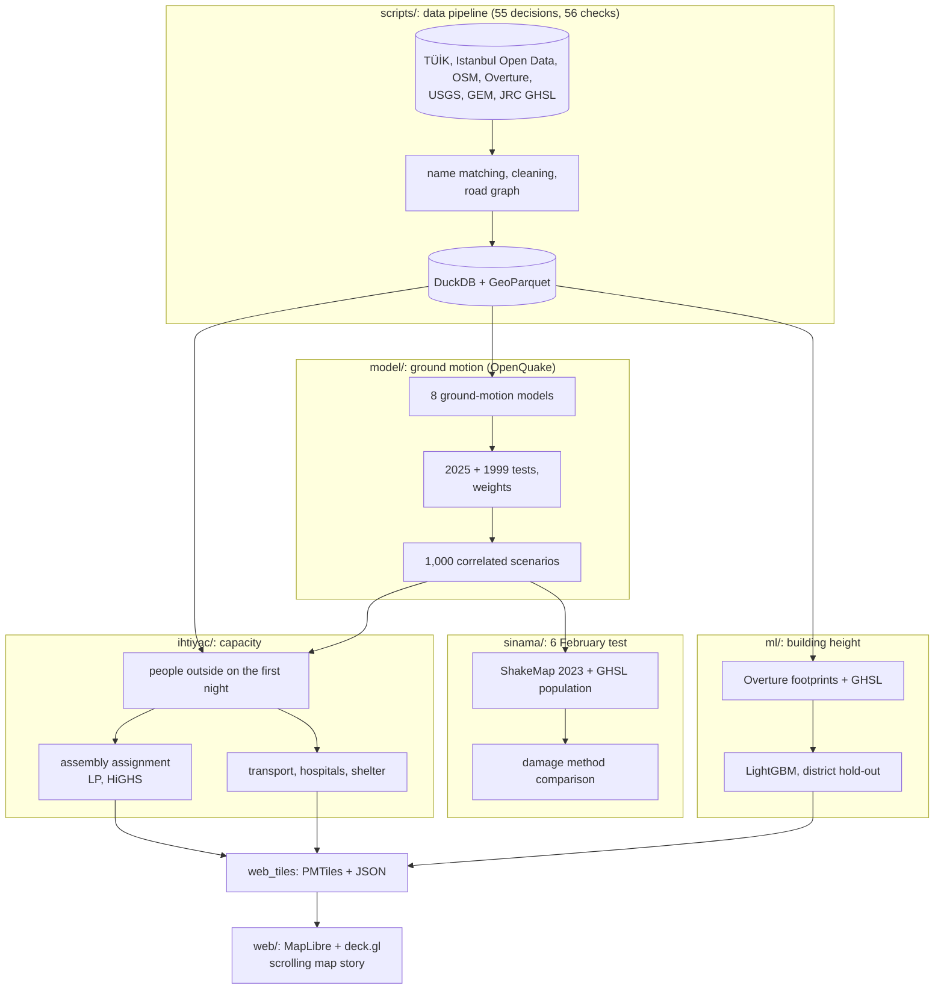

# Istanbul: The First Night

**English** | [Türkçe](README.tr.md)

A data analysis case study: on the first night after a major Istanbul earthquake, where can people walk to, and is there space for
them there?

The project started with a question from the 23 April 2025 Silivri earthquake (Mw 6.2), after seeing the crowds in Esenyurt's Turgut
Özal neighbourhood. It joins more than 25 open sources into a single table of 959 neighbourhoods, tests ground-motion models against
real recordings, solves the assembly-area assignment as a linear program, and estimates building heights with machine learning for a
3D map. It does not estimate casualties; the results rest on quantities that can be checked: people, area, distance, capacity. The site
is available in Turkish and English.

## Findings

- **Walking distance changes the picture.** On paper, Istanbul's open spaces over 2,000 m² hold 25 million people. Assigning ~49,000
  population blocks to spaces within 1 km under capacity limits, **2.7 million** of the ~9.1 million people outside on the first night of
  the median scenario find no space. The result depends most on how many people go outside: between 0.85 and 6.4 million. The gap is
  largest in the dense districts of the European side (Bağcılar 64%, Avcılar 57%, Bahçelievler 55%); in Turgut Özal it is 86–94% under
  every assumption.
- **Shaking can be tested.** Eight ground-motion models were tested against the 2025 Silivri (47 stations) and 1999 İzmit (25 stations)
  recordings and weighted by fit; one model (AS08) overestimated the 2025 recordings by ~2.3×.
- **Casualties cannot be tested with open data.** Common damage and loss methods, our own calibrations included, consistently
  underestimated the actual losses when run with the real shaking of 6 February 2023. The project therefore publishes no death counts.
- **Building heights.** A LightGBM model estimates floors for ~151,000 buildings with unknown height; mean error on held-out districts is
  1.66 floors (2.26 for a rule-based estimate).
- **Turgut Özal.** 28,564 people in 0.64 km² (~44,000 per km², 3.7× the Istanbul neighbourhood median); 4,372 m² of open space in the
  neighbourhood, against a standard camp area of 346,050 m² for the 7,690 people with shelter needs in the open scenario data.

## Architecture



**Why this stack:** The data fits on one machine (largest input ~1 GB), so DuckDB + GeoParquet instead of a server. OpenQuake provides
validated ground-motion model implementations; it does not support Python 3.14, so it lives in a separate 3.12 environment
(`.venv-oq`). The assembly assignment is a transportation problem with ~170,000 variables; SciPy's HiGHS solver handles it in half a
second. The site is static: basemap and buildings are single-file PMTiles, results are JSON, so no server or map API key is needed.
Every JSON file is validated in the browser with a zod schema.

## Setup

```bash
brew install osmium-tool libomp uv tippecanoe pmtiles && python3 -m venv .venv && .venv/bin/pip install -r requirements.txt && uv venv .venv-oq --python 3.12 && uv pip install --python .venv-oq/bin/python -r requirements-oq.txt && uv pip install --python .venv-oq/bin/python --no-deps openquake.engine==3.26.2 && .venv/bin/python scripts/hat.py && .venv/bin/python ihtiyac/w07_web_veri.py && npm --prefix web install && npm --prefix web run dev
```

Step order and reproduction: [docs/ILERLEME.md](docs/ILERLEME.md) (Turkish). Raw data is not in the repository; `scripts/00_indir.py`
downloads it. Map layers are built by `ihtiyac/w01`–`w06` and copied to the site by `w07`.

## Deployment

The site is static: the output of `npm --prefix web run build` (`web/dist`) can go on any static host. The map tiles
(`altlik.pmtiles` ~78 MB, `binalar.pmtiles` ~13 MB) are not in the repository; the pipeline builds them and
`ihtiyac/w07_web_veri.py` copies them to the site. PMTiles is read with HTTP range requests, so any host with `Range` support works
(GitHub Pages, Cloudflare R2 or similar).

## Documents

- [How we did it](docs/web_metin/HOW_WE_DID_IT.md) (the site's method page), [Turkish version](docs/web_metin/NASIL_YAPTIK.md)
- In Turkish: [data and cleaning](docs/VERI_RAPORU.md), [ground motion](docs/YONTEM_1_YER_HAREKETI.md),
  [damage and the 6 February test](docs/YONTEM_2_HASAR.md), [needs and assembly assignment](docs/YONTEM_5_IHTIYAC.md),
  [machine learning](docs/YONTEM_4_ML.md), and an earlier stage not in the main story: [72-hour simulation](docs/YONTEM_3_SIMULASYON.md)

## Limitations and note

This is an independent portfolio study; it does not forecast earthquakes, does not evaluate the plans or work of official institutions,
and does not replace them. The assembly result uses potential open spaces (over 2,000 m²) derived from open data; the official
assembly-area list is not openly available in bulk. Usable share, space per person and the share of people going outside are
assumptions and are reported with sensitivity ranges. Soil data is a coarse proxy, the building stock dates from 2017, and hospital beds
are distributed from the provincial total.

This work was made possible by data from the Istanbul Metropolitan Municipality Open Data Portal, TÜİK, AFAD, OpenStreetMap
contributors, Overture Maps, USGS, GEM and the European Commission's GHSL.
