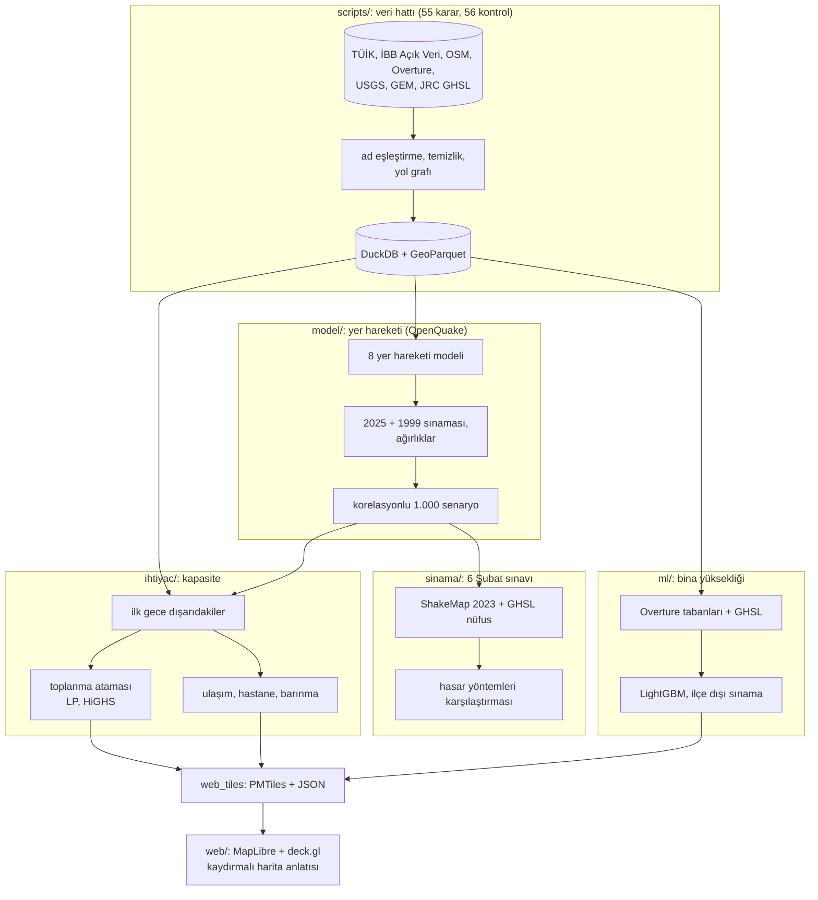

# İstanbul: İlk 72 Saat

Bir veri analizi vakası: büyük bir İstanbul depreminin ilk gecesinde insanlar yürüyerek nereye gidebilir, ve oralarda yer var mı?

Proje, 23 Nisan 2025 Silivri depreminde (Mw 6,2) Esenyurt Turgut Özal Mahallesi'nde yaşarken görülen kalabalıktan çıkan bir soruyla
başladı. 25'ten fazla açık kaynağı 959 mahallelik tek bir tabloda birleştiriyor, yer hareketi modellerini gerçek kayıtlarla sınıyor,
toplanma alanı atamasını doğrusal programlamayla çözüyor ve bina yüksekliklerini makine öğrenmesiyle tahmin edip 3B haritaya taşıyor.
Kayıp tahmini yapmıyor; sonuçlar sınanabilir büyüklüklere dayanıyor: kişi, alan, mesafe, kapasite.

## Bulgular

- **Yürüme mesafesi tabloyu değiştiriyor.** İstanbul'un 2.000 m²'den büyük açık alanları kağıt üstünde 25 milyon kişiyi alıyor. ~49 bin
  nüfus bloğunu 1 km içindeki alanlara kapasiteyle atayınca medyan senaryoda ilk gece dışarıdaki ~9,1 milyon kişiden **2,7 milyonu** yer
  bulamıyor. Sonuç en çok "kaç kişi dışarı çıkar" varsayımına bağlı: 0,85 ile 6,4 milyon arası. Açık en çok Avrupa yakasının yoğun
  ilçelerinde (Bağcılar %64, Avcılar %57, Bahçelievler %55); Turgut Özal'da bütün varsayımlarda %86–94.
- **Sarsıntı sınanabiliyor.** Sekiz yer hareketi modeli 2025 Silivri (47 istasyon) ve 1999 İzmit (25 istasyon) kayıtlarıyla sınanıp
  uyumlarına göre ağırlıklandırıldı; tek bir modelin (AS08) 2025 kayıtlarını ~2,3 kat fazla tahmin ettiği görüldü.
- **Kayıp, açık veriyle sınanamıyor.** Yaygın hasar ve kayıp yöntemleri, kendi kalibrasyonlarımız dahil, 6 Şubat 2023'ün gerçek
  sarsıntısıyla çalıştırıldığında gerçekleşen kaybı tutarlı biçimde düşük tahmin etti. Bu yüzden projede ölüm sayısı yayımlanmıyor.
- **Bina yüksekliği tahmini.** Kat sayısı bilinmeyen ~151 bin bina için LightGBM modeli; ilçe dışı sınamada ortalama hata 1,66 kat
  (kural tabanlı tahminde 2,26).
- **Turgut Özal.** 28.564 kişi 0,64 km²'de (km² başına ~44 bin, İstanbul mahalle medyanının 3,7 katı); mahalledeki açık alan 4.372 m²,
  açık senaryo verisindeki 7.690 kişilik barınma ihtiyacı için standart kamp alanı 346.050 m².

## Mimari



**Neden bu yığın:** Veri tek makineye sığıyor (en büyük girdi ~1 GB); sunucu yerine DuckDB + GeoParquet. Yer hareketi için OpenQuake
doğrulanmış model uygulamaları içeriyor; Python 3.14 ile uyumsuz olduğu için ayrı bir 3.12 ortamında (`.venv-oq`). Toplanma ataması
~170 bin değişkenli bir ulaştırma problemi; SciPy'nin HiGHS çözücüsü yarım saniyede çözüyor. Web statik: altlık harita ve binalar tek
dosyalık PMTiles, sonuçlar JSON; sunucu ya da harita servisi anahtarı gerekmiyor. Gelen her JSON tarayıcıda zod şemasından geçiyor.

## Kurulum

```bash
brew install osmium-tool libomp uv tippecanoe pmtiles && python3 -m venv .venv && .venv/bin/pip install -r requirements.txt && uv venv .venv-oq --python 3.12 && uv pip install --python .venv-oq/bin/python -r requirements-oq.txt && uv pip install --python .venv-oq/bin/python --no-deps openquake.engine==3.26.2 && .venv/bin/python scripts/hat.py && .venv/bin/python ihtiyac/w07_web_veri.py && npm --prefix web install && npm --prefix web run dev
```

Adım sırası ve yeniden üretim: [docs/ILERLEME.md](docs/ILERLEME.md). Ham veri repoya girmez; `scripts/00_indir.py` indirir. Harita
katmanları `ihtiyac/w01`–`w06` ile üretilir, `w07` siteye kopyalar.

## Yayın

Site statik: `npm --prefix web run build` çıktısı (`web/dist`) herhangi bir statik barındırmaya konabilir. Harita karoları
(`altlik.pmtiles` ~78 MB, `binalar.pmtiles` ~13 MB) repoya girmez; hat üretir, `ihtiyac/w07_web_veri.py` siteye kopyalar. PMTiles
HTTP aralık isteğiyle okunduğu için barındırmanın `Range` desteklemesi yeterli (GitHub Pages, Cloudflare R2 ya da benzeri).

## Belgeler

- [Nasıl yaptık (site metni)](docs/web_metin/NASIL_YAPTIK.md), [vaka çalışması](docs/web_metin/VAKA_CALISMASI.md)
- [Veri ve temizlik](docs/VERI_RAPORU.md)
- [Yer hareketi](docs/YONTEM_1_YER_HAREKETI.md), [hasar ve 6 Şubat sınavı](docs/YONTEM_2_HASAR.md)
- [İhtiyaç ve toplanma ataması](docs/YONTEM_5_IHTIYAC.md), [makine öğrenmesi](docs/YONTEM_4_ML.md)
- Ana anlatıda olmayan önceki aşama: [72 saat simülasyonu](docs/YONTEM_3_SIMULASYON.md)

## Sınırlılıklar ve not

Bu bağımsız bir portföy çalışmasıdır; deprem tahmini yapmaz, resmî kurumların plan ve çalışmalarını değerlendirmez ve onların yerine
geçmez. Toplanma sonucu açık veriden türetilmiş potansiyel açık alanlarla (2.000 m² üstü) yapılmıştır; resmî toplanma alanı listesi
toplu olarak açık olmadığı için kullanılamadı. Kullanılabilir pay, kişi başı alan ve dışarı çıkma oranı varsayımdır ve duyarlılıkla
verilir. Zemin verisi kaba bir vekil, bina stoğu 2017, hastane yatakları il toplamından dağıtıldı.

Çalışma İBB Açık Veri Portalı, TÜİK, AFAD, OpenStreetMap katkıcıları, Overture Maps, USGS, GEM ve Avrupa Komisyonu GHSL verileriyle
mümkün oldu.
