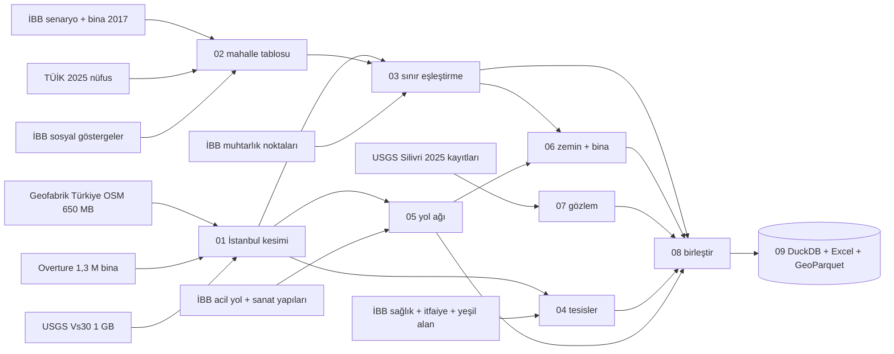

# Veri hazırlama raporu

_Otomatik üretildi: `scripts/09_yayinla.py`, 2026-10-11. Elle düzenlemeyin; betikleri değiştirip hattı yeniden çalıştırın._

## Özet

- **959 mahalle**, 39 ilçe; her mahallede senaryo, bina stoğu, 2025 nüfusu, güncel sınır, zemin, fay mesafesi, yol ağı erişim düğümü ve tesis sayıları var.
- **55 temizleme kararı** kayıtlı (sorun → etkilenen kayıt → karar → gerekçe).
- **56 otomatik kontrol**, 56 geçti, 0 kaldı.
- Mahalle tablosunun 84 sütunu veri türüne göre: gözlem 26, başka bir modelin çıktısı 23, türetilmiş 33, varsayım 2.
- Yol ağı: 194,520 düğüm, 507,531 yönlü kenar.

## Hat

## Kaynaklar

| katman | kaynak | lisans | erisim |
|---|---|---|---|
| Deprem senaryosu (Mw 7,5 gece) | İBB Açık Veri: deprem-senaryosu-analiz-sonuclari | İBB Açık Veri Lisansı | 2026-10-10 |
| Bina stoğu 2017 | İBB Açık Veri: mahalle-bazli-bina-analiz-verisi | İBB Açık Veri Lisansı | 2026-10-10 |
| Mahalle nüfusu 2025 | TÜİK ADNKS, belediye-köy-mahalle nüfusları | TÜİK (atıfla serbest) | 2026-10-11 |
| Mahalle ve ilçe sınırları, yol ağı, hastane/park etiketleri | OpenStreetMap, Geofabrik turkey-261008.osm.pbf | ODbL | 2026-10-11 |
| Bina ayak izleri | Overture Maps Foundation, buildings, release 2026-09-23.1 | ODbL / CDLA-Permissive (kaynağa göre) | 2026-10-11 |
| Zemin Vs30 | USGS Global Vs30 Mosaic (Heath vd. 2020) | Kamu malı (CC0) | 2026-10-10 |
| Marmara fay izleri | GEM Global Active Faults (EMME kayıtları) | CC BY-SA 4.0 | 2026-10-10 |
| 2025 Silivri Mw 6,2 kayıtları | USGS ShakeMap us7000pufs v8 (stationlist, grid) | Kamu malı | 2026-10-11 |
| 1. derece acil ulaşım yolları | İBB Açık Veri: 1-derece-acil-ulasim-yollari-verisi (UKOME 2024/2-1) | İBB Açık Veri Lisansı | 2026-10-11 |
| Köprü, viyadük, alt/üst geçit, tünel | İBB Açık Veri: ulasim-sanat-yapilari-veri-seti | İBB Açık Veri Lisansı | 2026-10-11 |
| Kentsel açık ve yeşil alanlar | İBB Açık Veri: kentsel-acik-ve-yesil-alanlar | İBB Açık Veri Lisansı | 2026-10-11 |
| İtfaiye istasyonları 2025 | İBB Açık Veri: itfaiye-istasyonlari-konum-bilgileri | İBB Açık Veri Lisansı | 2026-10-11 |
| Sağlık tesisleri | İBB Açık Veri: istanbul-saglik-kurum-ve-kuruluslari-verisi | İBB Açık Veri Lisansı | 2026-10-11 |
| İl yatak toplamı 2024 | TBMM tutanağı, İstanbul İl Sağlık Müdürlüğü sunumu (45.962 yatak; 24.351 kamu) | Kamuya açık | 2026-10-11 |
| Muhtarlık konumları | İBB Açık Veri: muhtarlik-adres-bilgileri | İBB Açık Veri Lisansı | 2026-10-11 |
| Sosyal yardım alan hane 2025 (mahalle) | İBB Açık Veri: mahallelere-gore-sosyal-yardim-alan-hane-sayisi | İBB Açık Veri Lisansı | 2026-10-11 |
| İlçe hane büyüklüğü 2024 | İBB Açık Veri: ilce-bazli-ortalama-hane-halki-buyuklugu | İBB Açık Veri Lisansı | 2026-10-11 |
| Engelli / kronik hastalıklı hane (ilçe, anket) | İBB VDYM araştırması | İBB Açık Veri Lisansı | 2026-10-11 |
| Sosyal hasar görebilirlik (ilçe) | İBB 2018 Sosyal Hasar Görebilirlik Analizi, Yönetici Özeti s.5 | Yalnızca atıfla, yeniden dağıtılmaz | 2026-10-10 |
| İl bina ruhsat istatistikleri | İBB Açık Veri: yapi-ruhsatina-gore-bina-sayisi | İBB Açık Veri Lisansı | 2026-10-11 |

## Temizleme kararları

### 01_istanbul_kirp

| no | katman | sorun | etkilenen | karar | gerekçe |
|---|---|---|---|---|---|
| 1 | OSM sınır | OSM il ilişkisi karasularını da kapsıyor (11,281 km²) | 1 | Kesim için iki sınır tutuldu: il (deniz dahil; köprü, ada, kıyı yolu kaybolmasın) ve kara (mahalle poligonlarının birleşimi) | Bina, zemin ve nüfus gibi kara katmanları deniz alanıyla bölünürse yoğunluklar yarıya düşer |
| 2 | OSM | Türkiye dosyası (650 MB) analiz için gereğinden büyük | 1 | osmium ile önce Marmara kutusu, sonra il poligonu (complete_ways) ile kesildi | complete_ways sınırı kesen yolların tamamını tutar; il sınırında yol ağı kopmaz |
| 3 | Overture bina | Kutu sorgusu Kocaeli/Tekirdağ binalarını da içeriyor | 152805 | Bina merkezi kara poligonunun içinde olanlar tutuldu | Bina merkez noktası tek bir ile düşer; sınırdaki bina çift sayılmaz |
| 4 | Vs30 | Mozaikte su yüzeyleri 600 m/s sabit değerle doldurulmuş | 26 | Kara poligonuyla kesildikten sonra kalan 600 m/s hücreleri 06_zemin_bina'da su/dolgu olarak işaretlenir | Değer eşitliğiyle silmek kara üstündeki gerçek 600 m/s hücreleri de siler; önce kara maskesi, sonra değer kontrolü |

### 02_mahalle_tablosu

| no | katman | sorun | etkilenen | karar | gerekçe |
|---|---|---|---|---|---|
| 5 | İBB | Dosyalar UTF-8 değil (cp1254), ayraç ';' | 2 | cp1254 ile okundu | UTF-8 okumak Türkçe harfleri bozar (HEYBEL�ADA) ve ad eşleştirmesini kırar |
| 6 | İBB bina | Excel '19 MAYIS' mahalle adını tarihe çevirmiş ('19.May') | 3 | Ad, senaryo tablosundaki ad ile değiştirildi (anahtar UAVT olduğu için birleştirme etkilenmedi) | Büyükçekmece, Kadıköy ve Şişli'deki 19 Mayıs mahalleleri; aynı hata ad üzerinden eşleşen her kaynakta veri kaybettirir |
| 7 | İBB bina | Kat sınıfı etiketleri çakışıyor ('5-9' ve '9-19'; 9 kat iki sınıfta) ve 20+ kat sınıfı yok | 959 | Sınıflar kaynakta olduğu gibi tutuldu: kat_1_4, kat_5_9, kat_9_19; '20+' bilgisi yok diye not edildi | Kaynakta hangi sınırın açık/kapalı olduğu belirtilmemiş; yeniden dağıtmak uydurma olurdu |
| 8 | İBB senaryo | 'gecici_barinma' sütununun birimi (kişi/hane) kaynakta yazmıyor | 959 | Birim HANE kabul edildi; sütun barinma_hane olarak adlandırıldı, kişi karşılığı ilçe hane büyüklüğüyle türetildi | (1) İBB'nin 'barınma ihtiyacı hane sayısı' grafiğindeki ilçe sıralaması (Küçükçekmece, Esenyurt, Bahçelievler, Bağcılar, Fatih) bu sütunla birebir aynı; (2) toplam / orta+ hasarlı bina = 4.30, İstanbul'da bina başına ~4,5 hane ile tutarlı, kişi olsaydı bina başına 4,3 kişi olurdu ki bu çok düşük |
| 9 | TÜİK | Aynı UAVT kodu 2025'te başka adla kayıtlı (ad değişikliği, ör. Esenler Havaalanı → Atışalanı) | 13 | TÜİK 2025 adı mahalle_2025 sütununda tutuldu; sınır eşleştirmesinde ek ad kanıtı olarak kullanılır | Kod aynı kaldığı için bu, ad değişikliğinin resmî kanıtıdır |
| 10 | TÜİK | UAVT kodu TÜİK'te değişmiş mahalleler (Beykoz, Silivri, Şile köyden mahalleye dönüşenler) | 8 | Aynı ilçe + aynı katlanmış adla eşleştirildi (nufus_kaynagi='tuik_ad') | Ad ilçe içinde tekil; kod değişikliği idari, mahalle aynı |
| 11 | TÜİK | Ümraniye/Saray 2025 TÜİK ve 2025 muhtarlık listelerinde yok; yerine Finanskent var | 1 | Saray'a Finanskent nüfusu (8.861) atandı, nufus_kaynagi='tuik_varsayim_finanskent' ile bayraklandı | Finanskent, Saray'ın bulunduğu Finans Merkezi alanında kurulmuş; mekânsal eşleşme 03_mahalle_sinirlari'nda elle kayıtla yapılır |
| 12 | TÜİK | 2017 sonrası kurulan, İBB senaryosunda olmayan mahalleler | 2 | Analiz birimine eklenmedi; nüfusları raporda ayrı gösterildi: 15 Temmuz (12,012), 5.Levent (13,258) | Senaryo çıktısı olmadan hasar modeline giremezler; nüfus toplamında fark olarak görünürler |
| 13 | VDYM | VDYM dosyaları anket örneklem sayısı (evet/hayır hane), nüfus sayımı değil | 39 | Oran = evet / (evet + hayır) olarak ilçe düzeyinde kullanıldı | Ham sayılar örneklem büyüklüğüne bağlı; karşılaştırılabilir olan orandır |
| 14 | Sosyal yardım 2025 | Excel '19 MAYIS' ve '15 TEMMUZ' adlarını tarihe çevirmiş (2026-05-19, 2026-07-15) | 5 | Tarih hücreleri gün + Türkçe ay adına geri çevrildi | Onarılmasa bu 5 mahallenin (1.171 hane) yardım verisi eşleşmeden düşerdi |
| 15 | Sosyal yardım 2025 | Güncel ad ile 2017 adı farklı (Bağcılar Evren → 15 Temmuz; Büyükçekmece Mimarsinan Merkez → Mimarsinan) | 2 | MAHALLE_ESANLAM tablosuyla eski ada bağlandı | Aynı ilçede, aynı UAVT; 15 Temmuz Bağcılar'da Evren'in yeni adı (Esenler'deki 15 Temmuz ayrı mahalle) |
| 16 | Sosyal yardım 2025 | Mahalle adları İBB senaryo tablosundan farklı yazılmış | 0 | 952 tam ad eşleşmesi + 0 aynı ilçe içi bulanık eşleşme (benzerlik ≥ 0,85); eşleşmeyen boş bırakıldı | Eşleşmeyen mahallede yardım yok demek değildir, 0 yazılmadı |
| 17 | Sosyal yardım 2025 | Listede hiç yer almayan mahalleler | 7 | Nüfusu 500'den az olan 7 mahallede 0 yazıldı, bayrak sosyal_yardim_listede_yok=True; kalanlar boş | Fatih tarihî yarımadadaki 11–142 kişilik ticaret mahallelerinde yardım alan hane olmaması beklenen durum; büyük mahallede yokluk veri eksiği sayılır |
| 18 | Sosyal yardım | 2023 ve 2025 dosyalarının tanımı farklı görünüyor (2025 adı 'İstanbulkart') | 959 | 2025 kullanıldı | İki yılın mahalle sıralaması Spearman ρ = 0,99; tanım farkı sıralamayı değiştirmiyor, 2025 daha güncel ve daha eksiksiz (958 satır) |

### 03_mahalle_sinirlari

| no | katman | sorun | etkilenen | karar | gerekçe |
|---|---|---|---|---|---|
| 19 | Muhtarlık | 'Mahalle Adı' sütunu ile muhtarlığın kendi adı farklı (ör. Yenidoğan muhtarlığı 'ORTA' mahallesi görünüyor) | 115 | Mahalle adı 'Muhtarlık Adı' alanından türetildi; 'Mahalle Adı' yalnızca yedek varyant | Muhtarlığın adı kurumun kendi beyanı; 'Mahalle Adı' sütunu kaymış/kopyalanmış görünüyor |
| 20 | Muhtarlık | Muhtarlık noktası beyan edilen ilçenin dışına düşüyor | 0 | Bu noktalar mekânsal kanıt olarak kullanılmadı | Ya ilçe alanı ya koordinat hatalı; hangisi olduğu bilinmeden kanıt sayılamaz |
| 21 | Sınır eşleştirme | İBB 2017 mahalle adları ile 2026 OSM sınır adları birebir aynı değil | 115 | Dağılım: ad+muhtarlık 844, ad 112, bulanık 1, muhtarlık 1, elle 1 | Ad (İBB 2017 + aynı UAVT'nin TÜİK 2025 adı) önce; muhtarlık noktası teyit; bulanık ve elle eşleşmeler raporda tek tek listelenir |
| 22 | Sınır | Dudullu OSB Mahallesi 2017'de yoktu | 1 | Poligonu ana mahalle ESENKENT ile birleştirildi | Önceki OSM sınırlarında alanının %76'i ESENKENT içinde; 2017 bina stoğu ve senaryo bu alanı ESENKENT altında sayar |
| 23 | Sınır | Beylikdüzü Organize Sanayi Bölgesi 2017'de yoktu | 1 | Poligonu ana mahalle YAKUPLU ile birleştirildi | Önceki OSM sınırlarında alanının %83'i YAKUPLU içinde; 2017 bina stoğu ve senaryo bu alanı YAKUPLU altında sayar |
| 24 | Sınır | 15 Temmuz Mahallesi 2017'de yoktu | 1 | Poligonu ana mahalle ORUÇREİS ile birleştirildi | Önceki OSM sınırlarında alanının %99'i ORUÇREİS içinde; 2017 bina stoğu ve senaryo bu alanı ORUÇREİS altında sayar |
| 25 | Sınır | 5. Levent Mahallesi 2017'de yoktu | 1 | Poligonu ana mahalle GÜZELTEPE ile birleştirildi | Önceki OSM sınırlarında alanının %100'i GÜZELTEPE içinde; 2017 bina stoğu ve senaryo bu alanı GÜZELTEPE altında sayar |
| 26 | Sınır | 2017 listesinde karşılığı olmayan, tek bir ana mahalleye de bağlanamayan OSM bölgesi | 1 | senaryo_disi_bolge katmanına ayrıldı: İkitelli OSB Mahallesi | İkitelli OSB eski sınırlarda da ayrı bir 'Organize Sanayi Bölgesi' alanı; İBB senaryosunda mahalle olarak yok, sanayi alanı (gece nüfusu ~0) |

### 04_tesisler

| no | katman | sorun | etkilenen | karar | gerekçe |
|---|---|---|---|---|---|
| 27 | Hastane | 'Şehir Hastanesi' kategorisinde hastane olmayan kayıtlar (ör. 'istanbul Şehir', 'iski Şehir', 'Mega Şehir') | 56 | Çıkarıldı | Yatak dağıtımında ve sismik izolatör varsayımında şehir hastanesi sayılıp kapasite çalıyorlardı |
| 28 | Hastane | Üniversite hastanelerinin sektörü kaynakta yok | 45 | Devlet üniversitesi adı geçenler kamu, diğerleri (vakıf) özel sayıldı | Bakanlık yatak istatistiği vakıf üniversitelerini özel sektörde verir |
| 29 | Hastane | Koordinatı il kara alanı dışına düşen kayıt | 0 | Çıkarıldı | Koordinat hatası; adresle düzeltme ayrı bir iş |
| 30 | Hastane | Aynı hastane kampüsü için birden çok kayıt (bölüm, acil girişi, ek bina) | 144 | 120 m içindeki kayıtlar tek tesiste birleştirildi: 472 kayıt → 328 tesis | Kapasite ve en yakın hastane hesabı çift saymasın |
| 31 | Hastane | Kampüs poligonu/binası bulunamayan veya <500 m² hastane | 20 | Kapasite ağırlığı aynı sektörün medyan kampüs alanıyla dolduruldu (bayrak: kapasite_kaynagi='sektor_medyani') | 0 ağırlık hastaneyi kapasitesiz gösterirdi; medyan nötr varsayım |
| 32 | Hastane | Tesis bazında yatak sayısı açık veride yok | 328 | İl toplamı (2024: 24.351 kamu + 21.611 özel) kampüs kat alanı oranında dağıtıldı (yatak_tahmini) | Doğrulama: OSM'de yatak etiketi olan 8 hastanede Spearman ρ = 0.60; tahmin büyüklük sırasını yakalıyor, tekil değer değil |
| 33 | Hastane | Acil servis bilgisi çoğu kayıtta yok | 214 | OSM etiketi varsa o; yoksa genel hastane = acil var, uzman dal (ruh sağlığı, göz, diş, FTR) = yok | Yataklı genel hastanelerde acil servis Bakanlık yönetmeliği gereği zorunlu; eksik etiket 'yok' demek değil |
| 34 | İtfaiye | Koordinat sütun etiketleri ters: 'Koordinat(Y)' boylam, 'Koordinat(X)' enlem içeriyor | 136 | Değer aralığına göre lon=Koordinat(Y), lat=Koordinat(X) okundu | Y değerleri 28–30 (boylam), X değerleri 40,8–41,5 (enlem) |
| 35 | Toplanma | İBB yeşil alan katmanında refüj, kavşak ve metro çıkışı poligonları var | 539 | Çıkarıldı | Trafik adası toplanma alanı değildir |
| 36 | Toplanma | İBB ve OSM aynı parkı ayrı ayrı (ve OSM'de parça parça) çiziyor | 2246 | 11,390 poligon çözülerek 9,144 bitişik alana indirildi | Çift sayım alan kapasitesini şişirirdi |
| 37 | Toplanma | Hangi açık alan toplanmaya uygun sayılmalı? | 2960 | alan ≥ 2.000 m² (AFAD kriterlerindeki en küçük ölçeğe yakın) 'uygun'; tümü saklandı, eşik analizde değiştirilebilir | Resmî AFAD listesi (İstanbul'da ~3.000 alan) toplu indirilebilir değil; bu katman 'potansiyel' olarak etiketlenir |
| 38 | Acil yol | YAKA alanı '0' olan kayıt | 4 | Yaka konumdan (boylam > 29,0° Anadolu) atandı | Boğaz hattı ~29,0°; kesin değil ama bu 4 kayıt için ilçe adıyla da kontrol edildi |
| 39 | Sanat yapısı | Katmanda istinat duvarı, menfez, yaya ve raylı geçitler de var | 5674 | Karayolu trafiğini taşıyan 2,434 yapı (köprü, viyadük, araç alt/üst geçidi, tünel) tutuldu | Yol ağı kırılganlığı yalnızca araç trafiği taşıyan yapılarla ilgilidir |

### 05_yol_agi

| no | katman | sorun | etkilenen | karar | gerekçe |
|---|---|---|---|---|---|
| 40 | Yol ağı | Ana ağa bağlı olmayan yol parçaları (kapalı siteler, tek yön hataları, eşleme kopuklukları) | 2473 | En büyük güçlü bağlı bileşen tutuldu: 194,520/196,993 düğüm (%98.7) | Güçlü bağlı olmayan düğümden çıkış veya o düğüme varış yolu olmayabilir; erişim süresi sonsuz çıkar |
| 41 | Yol ağı | maxspeed etiketi kenarların çoğunda yok | 485518 | Etiket varsa o (%4), yoksa sınıf varsayılanı (HIZ tablosu); gece serbest akış | Senaryo gece 03:00; trafik yoğunluğu ihmal edilebilir, hasar kaynaklı yavaşlama simülasyonda ayrıca modellenir |
| 42 | Yol ağı | Köprü/viyadük/tünel bilgisi iki kaynakta farklı kapsamda | 10736 | OSM bridge/tunnel etiketi VEYA 12 m içinde İBB sanat yapısı → kritik_yapi; kaynak sütunu tutuldu | Simülasyonda bu kenarlar ayrı kırılganlık eğrisi alır; tek kaynak eksik kalır (İBB alt geçitleri OSM'de çoğu zaman etiketsiz) |
| 43 | Erişim | Mahalle erişim noktası olarak çokgen merkezi, ormanlık/büyük mahallelerde yerleşimin dışına düşebiliyor | 959 | Bina taban alanı ağırlıklı merkez kullanıldı; binası olmayan 0 mahallede çokgen iç noktası | Erişim süresi insanların yaşadığı yerden ölçülmeli |
| 44 | Erişim | Erişim noktası ana yol ağına 1,5 km'den uzak mahalleler (Adalar) | 5 | yol_erisimi='deniz', düğüm boş bırakıldı | Ana ağa köprüsü olmayan adada kara yolu süresi anlamsız; simülasyonda deniz lojistiği ayrı modellenir |

### 06_zemin_bina

| no | katman | sorun | etkilenen | karar | gerekçe |
|---|---|---|---|---|---|
| 45 | Overture bina | Taban alanı < 15 m² çok küçük poligonlar (kulübe, trafo, çizim artığı) | 24839 | Sayımdan çıkarıldı (bina_sayisi_overture), toplam taban alanında tutuldu | İBB bina sayımı yaşanabilir yapıları sayar; trafo/kulübe sayıyı şişirir |
| 46 | Overture bina | Bina sayısı 2017'ye göre 3 kattan fazla farklı olan mahalleler | 45 | Silinmedi; bina_sayisi_supheli=True ile bayraklandı | Ya hızlı kentsel dönüşüm/yeni yapılaşma (Başakşehir, Arnavutköy) ya da OSM/ML çizim eksiği; hangisi olduğu tek tek bilinmez |
| 47 | Overture bina | Kat/yükseklik bilgisi binaların yalnızca ~%6'sında var | 70753 | Kat sayısı için İBB 2017 kat sınıfları esas alındı; Overture yalnız taban alanı ve sayım için kullanıldı | Seçici eksiklik (kat bilgisi daha çok yeni/büyük binalarda) ortalamayı yanlı yapar. Kontrol: yüksek bina oranı ile taban alanı medyanı ρ = 0.66 |
| 48 | Vs30 | Kara maskesinden sonra da 600 m/s su dolgusu kalan kıyı hücreleri | 26 | Boş sayıldı | Su yüzeyi dolgu değeri, ölçüm değil |
| 49 | Vs30 | USGS mozaiği topoğrafya eğiminden türetilmiş kaba bir vekil (~900 m) | 959 | Bina ağırlıklı ortalama 'vs30' sütunu; alan ortalaması da tutuldu | Kıyı dolguları ve alüvyon (Avcılar, Zeytinburnu, Bakırköy kıyısı) bu çözünürlükte E sınıfı görünmez; bu bilinen bir sınırlılık |

### 07_yer_hareketi_gozlem

| no | katman | sorun | etkilenen | karar | gerekçe |
|---|---|---|---|---|---|
| 50 | Silivri 2025 | Bazı istasyonlarda yatay PGA yok ya da USGS tarafından işaretlenmiş (flag≠0) | 0 | Bu istasyonlar çıkarıldı | İşaretli genlik (kırpılmış, gürültülü) doğrulamada yanlılık yaratır |
| 51 | Silivri 2025 | İstasyon listesinde 516 DYFI 'hissettim' bildirimi var (ölçüm değil, şiddet) | 73 | Ayrı tabloya ayrıldı (silivri2025_dyfi) | Ölçülmüş ivme ile anket şiddeti aynı doğrulama setinde karıştırılmaz |
| 52 | Silivri 2025 | ShakeMap ızgarası istasyon kayıtlarıyla koşullanmış bir enterpolasyondur (yine model + gözlem karışımı) | 959 | Mahalle değerleri 'ShakeMap tahmini' olarak etiketlendi; doğrulamada yalnızca istasyon kayıtları gözlem sayılır | Izgarayı gözlem sayıp modelimizi ona göre ayarlamak döngüsel olur |

### 08_birlestir

| no | katman | sorun | etkilenen | karar | gerekçe |
|---|---|---|---|---|---|
| 53 | Türetme | Mutlak sayılar büyük mahalleyi riskli gösterir (ölçek etkisi) | 959 | Oranlar üretildi: hasar_agir_ustu_oran (hedef değişken adayı), eski/yüksek bina oranı, yoğunluklar, can_kaybi_binde | Model ve haritalar oran üzerinden kurulur; can_kaybi_binde paydası 2025 nüfusu, İBB'nin kullandığı nüfus yayımlanmadı (yaklaşık) |

### d03a_istanbul_hucre

| no | katman | sorun | etkilenen | karar | gerekçe |
|---|---|---|---|---|---|
| 54 | GHSL | İstanbul penceresindeki yapılı hücrelerin bir kısmı il kara sınırı dışında (komşu il, deniz kenarı piksel) | 70066 | Mahalle poligonu dışındaki hücreler çıkarıldı | Aktarım yalnızca İstanbul mahallelerine uygulanır; mahalle toplamları İBB ile karşılaştırılacak |
| 55 | Vs30 | Kıyı bloklarının bir kısmı Vs30 rasterında su/boş hücreye düşüyor | 17 | Bloğun bulunduğu mahallenin Vs30 değeri atandı | Mahalle Vs30 değeri bina ağırlıklı, aynı kaynaktan |

## Otomatik kontroller

| adim | kontrol | sonuc | detay |
|---|---|---|---|
| 01_istanbul_kirp | OSM'de tek İstanbul il poligonu | GEÇTİ | 1 kayıt |
| 01_istanbul_kirp | İl içinde 39 ilçe poligonu | GEÇTİ | 39 ilçe |
| 01_istanbul_kirp | Kara alanı TÜİK yüzölçümüyle uyumlu | GEÇTİ | 5,407 km² (TÜİK 5.343) |
| 01_istanbul_kirp | Overture İstanbul bina sayısı İBB 2017 (1,17 M) ile aynı mertebede | GEÇTİ | 1,149,698 bina |
| 01_istanbul_kirp | Vs30 kesiti boyutu makul | GEÇTİ | 94x240, geçerli 8,930 hücre, 600'lük 26 |
| 02_mahalle_tablosu | Senaryo UAVT benzersiz | GEÇTİ | 959 satır |
| 02_mahalle_tablosu | Bina UAVT benzersiz | GEÇTİ | 959 satır |
| 02_mahalle_tablosu | İki İBB tablosu aynı UAVT kümesi | GEÇTİ | 959 ortak |
| 02_mahalle_tablosu | Aynı UAVT iki tabloda aynı ad (tarih onarımı sonrası) | GEÇTİ | 0 farklı |
| 02_mahalle_tablosu | Eksik değer yok | GEÇTİ | 0 hücre |
| 02_mahalle_tablosu | Negatif değer yok | GEÇTİ | tüm sayısal sütunlar |
| 02_mahalle_tablosu | Yaş sınıfı toplamı = kat sınıfı toplamı | GEÇTİ | 0 farklı mahalle |
| 02_mahalle_tablosu | Hasarlı bina ≤ toplam bina | GEÇTİ | en yüksek oran 0.83 |
| 02_mahalle_tablosu | Can kaybı olan her mahallede ağır+ hasar var | GEÇTİ | 0 istisna |
| 02_mahalle_tablosu | İlçe+ad anahtarı benzersiz | GEÇTİ | 0 çift |
| 02_mahalle_tablosu | TÜİK kodu benzersiz | GEÇTİ | 961 mahalle, toplam 15,753,640 |
| 02_mahalle_tablosu | Her mahallenin 2025 nüfusu var | GEÇTİ | 0 eksik |
| 02_mahalle_tablosu | Nüfus toplamı TÜİK toplamıyla uyumlu (fark = yeni mahalleler) | GEÇTİ | TÜİK 15,753,640 = İBB eşleşen 15,728,370 + yeni 25,270 |
| 02_mahalle_tablosu | Her ilçenin hane büyüklüğü var | GEÇTİ | yıl 2024 |
| 02_mahalle_tablosu | Her ilçenin sosyal görebilirlik puanı var | GEÇTİ | 39 ilçe |
| 02_mahalle_tablosu | engelli_hane_orani_ilce her ilçede var | GEÇTİ | örneklem 50,390 hane |
| 02_mahalle_tablosu | kronik_hane_orani_ilce her ilçede var | GEÇTİ | örneklem 50,390 hane |
| 02_mahalle_tablosu | Sosyal yardım eşleşme oranı ≥ %97 | GEÇTİ | 959/959 |
| 02_mahalle_tablosu | Sosyal yardım oranı < 1 | GEÇTİ | maks 0.400 |
| 03_mahalle_sinirlari | Her OSM mahallesinin ilçesi belirlendi | GEÇTİ | 964 poligon |
| 03_mahalle_sinirlari | Ad eşleşmesinin muhtarlık noktasıyla teyidi | GEÇTİ | 844/956 (%88) ad eşleşmesinde muhtarlık noktası aynı poligonda |
| 03_mahalle_sinirlari | Bir OSM poligonu en fazla bir İBB mahallesine bağlı | GEÇTİ | 0 paylaşılan poligon |
| 03_mahalle_sinirlari | Her İBB mahallesinin sınırı var | GEÇTİ | 0 eksik |
| 03_mahalle_sinirlari | Mahalle poligonları geçerli | GEÇTİ | 0 geçersiz |
| 03_mahalle_sinirlari | Mahalle poligonları üst üste binmiyor (≤1 ha) | GEÇTİ | en büyük örtüşme 0.00 ha |
| 03_mahalle_sinirlari | Mahalleler kara alanının ≥%95'ini kapsıyor | GEÇTİ | %99.9 (geri kalanı senaryo dışı bölge) |
| 04_tesisler | Tahmini yatak ile OSM yatak etiketi aynı sırada (Spearman ρ ≥ 0,5) | GEÇTİ | n=8, ρ=0.60 |
| 04_tesisler | Yatak toplamı Bakanlık il toplamına eşit | GEÇTİ | 45,954 |
| 04_tesisler | Her hastane bir mahalleye atandı | GEÇTİ | 328 hastane |
| 04_tesisler | İtfaiye noktaları il kara alanında | GEÇTİ | 136 birim |
| 04_tesisler | Acil yol UZUNLUK alanı geometriyle tutarlı (%2 içinde) | GEÇTİ | geometri 2,606.6 km, alan 2,607.1 km; %100.0 kayıt tutarlı |
| 05_yol_agi | Ağın ≥%95'i tek güçlü bileşende | GEÇTİ | %98.7 |
| 05_yol_agi | İBB acil yollarının ≥%85'i grafta acil_yol kenarıyla karşılanıyor | GEÇTİ | %97.6 (130,646 örnek nokta) |
| 05_yol_agi | Kara mahallelerinin %95'inde erişim noktası yola ≤300 m | GEÇTİ | medyan 36 m, %95 254 m, maks 1491 m |
| 06_zemin_bina | Overture bina kimliği benzersiz | GEÇTİ | 1,149,698 bina |
| 06_zemin_bina | Binaların ≥%99'u bir mahalleye düştü | GEÇTİ | %99.88 (kalan: senaryo dışı OSB) |
| 06_zemin_bina | Overture ve İBB 2017 mahalle bina sayıları aynı sırada (ρ ≥ 0,8) | GEÇTİ | Spearman ρ = 0.832 |
| 06_zemin_bina | Her mahallenin Vs30 değeri var | GEÇTİ | aralık 255–635 m/s, D sınıfı 159 |
| 06_zemin_bina | Fay mesafesi makul aralıkta (5–90 km) | GEÇTİ | 8.8–70.1 km |
| 07_yer_hareketi_gozlem | İvmeölçer kaydı sayısı yeterli (≥40) | GEÇTİ | 81 istasyon, ağ: {'KO': 68, 'HL': 9, 'HT': 3, 'GE': 1} |
| 07_yer_hareketi_gozlem | PGA fiziksel aralıkta (0–2 g) | GEÇTİ | maks 0.319 g @ CRLU |
| 07_yer_hareketi_gozlem | Tüm mahalleler ShakeMap ızgarasının içinde | GEÇTİ | İstanbul'da PGA 0.010–0.146 g, MMI 3.6–7.0 |
| 08_birlestir | Birleştirme sonrası 959 satır, UAVT benzersiz | GEÇTİ | 959 satır |
| 08_birlestir | Toplam korunuyor: bina_cok_agir | GEÇTİ | 13,496 |
| 08_birlestir | Toplam korunuyor: can_kaybi | GEÇTİ | 14,145 |
| 08_birlestir | Toplam korunuyor: barinma_hane | GEÇTİ | 835,918 |
| 08_birlestir | Toplam korunuyor: hastanede_tedavi | GEÇTİ | 39,636 |
| 08_birlestir | Hasarlı bina oranı [0,1] | GEÇTİ | maks 0.55 |
| 08_birlestir | Hastane yatak toplamı korunuyor | GEÇTİ | 45,954 |
| 08_birlestir | Her sütunun sözlük tanımı var | GEÇTİ | 84 sütun |
| d03a_istanbul_hucre | Tüm blokların Vs30 değeri var | GEÇTİ | 40840 blok, 273120 hücre, 959 mahalle |

## Bilinen sınırlılıklar

- İBB senaryo sütunları **model çıktısıdır**, gözlem değildir. Bu proje gerçek bir depremi tahmin etmez; senaryonun neyi neye bağladığını açıklar ve üstüne bir müdahale simülasyonu kurar.
- Bina stoğu 2017, nüfus 2025. Overture bina sayısıyla mahalle sırası ρ = 0,83 tutarlı; tarihî yarımadada Overture blokları birleşik çizdiği için az sayar.
- Vs30 (~900 m, topoğrafya vekili) kıyı dolgularını ve alüvyonu yakalayamaz; İstanbul'da E sınıfı hiç çıkmıyor, gerçekte var.
- Hastane yatakları tesis bazında açık veride yok; il toplamı kat alanına göre dağıtıldı (OSM'deki 8 yatak etiketiyle ρ = 0,60, zayıf doğrulama).
- Resmî AFAD toplanma alanı listesi indirilebilir değil; açık alan katmanı 'potansiyel' olarak etiketli. Uygun alan sayısı (2.960) AFAD'ın açıkladığı 3.021 ile aynı mertebede.
- Sosyal görebilirlik yalnızca ilçe düzeyinde (39 değer); mahalle düzeyi yoksunluk vekili olarak sosyal yardım oranı kullanılabilir.

## Dosya haritası

| Yol | Ne |
|---|---|
| `data/raw/` | Kaynaktan indirildiği gibi, dokunulmaz (repoya girmez) |
| `data/interim/` | Ara ürünler: İstanbul kesimleri, eşleştirme, log/QC JSONL |
| `data/processed/istanbul72.duckdb` | Tüm temiz tablolar + log + QC + sözlük + kaynaklar |
| `data/processed/*.parquet` | GeoParquet katmanları (mahalle, hastane, yol_kenar …) |
| `data/processed/istanbul72_veri.xlsx` | Gezmek için Excel |
| `data/interim/eslesme_inceleme.csv` | 'ad+muhtarlık' dışındaki her sınır eşleşmesi, elle göz atmak için |
| `scripts/01…09` | Hat; `python scripts/hat.py` hepsini sırayla çalıştırır |
