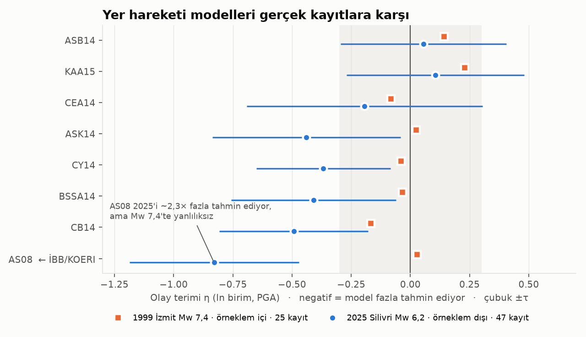
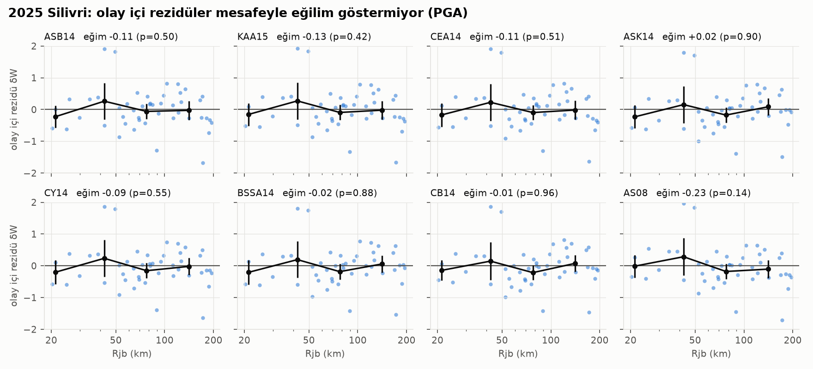
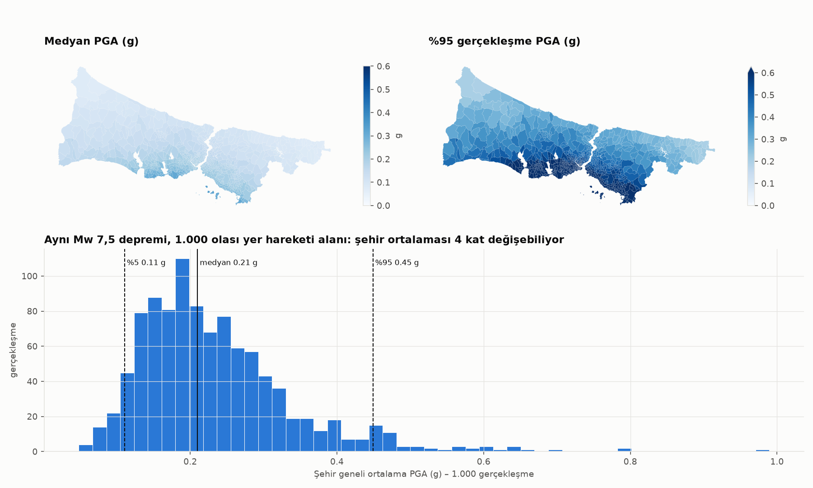

# Yöntem 1 – Yer hareketi modeli

Amaç: İBB/KOERI senaryosunun (Mw 7,5, Ana Marmara Fayı'nın kırılmamış orta kesimi) yer hareketini **belirsizliğiyle**
üretmek ve kullanılan denklemleri **gerçek kayıtlarla sınamak**. Kod: `model/yh_*.py` (OpenQuake 3.26, Python 3.12, `.venv-oq`).

## İBB/KOERI ne yaptı (KOERI 2010 raporu §2.1; 2019 güncellemesi aynı çerçeve)

- Deterministik senaryo, Mw 7,5, segment 5–8; olasılıksal tehlike ayrıştırmasından (50 yılda %50) türetilmiş.
- Tek denklem: Abrahamson & Silva (2008, AS08), 250 m mikrobölgeleme Vs30'u.
- **Yalnızca medyan (ε = 0).** Rapor da "sonuçlar %50 ihtimalle altında, %50 üstünde" diyor; dağılım verilmiyor.
  Aynı raporun dört analitik yöntemi 10.000–30.000 can kaybı aralığı veriyor, yayımlanan tek sayı bu aralığı gizliyor.

## Bu projede

| Bileşen | Seçim | Gerekçe |
|---|---|---|
| Kaynak | GEM EMME ME_TRCS013 izi (~105 km), düşey, sağ yanal, 0–15 km | Kırılmamış orta Marmara kesimi = KOERI segment 5–8; sismojenik taban GEM'den |
| Büyüklük | Mw 7,5 | İBB ile karşılaştırılabilirlik. Not: 105×15 km alan Leonard (2010) ile ~Mw 7,2; alternatif senaryolar ayrıca koşulacak |
| Denklemler | 8 aday: ASB14, KAA15, BSSA14, CY14, ASK14, CB14, CEA14, AS08 | Bölgesel (Türkiye/Avrupa), küresel NGA-West2 ve İBB'nin kendi seçimi |
| Ağırlıklar | LLH (Scherbaum vd. 2009), iki depremin ortalaması, w ∝ 2^−LLH | Veri güdümlü; elle ağırlık yok |
| Olaylar arası | η ~ N(0, C_BJ08), τ ile ölçekli | Tüm şehir aynı η'yı paylaşır: kayıpların en büyük ortak belirsizliği |
| Olay içi | LMC: BJ08 periyotlar arası × JB09 uzamsal (Vs30 kümelenmeli) | OpenQuake bunu periyotlar arası bağımsız üretir; bu, toplam kayıp dağılımını daraltır |
| Örnekleme | 1.000 olay, GMPE tabakalı örnekleme, tohum 72, μ + 3σ kırpma (%0,13 değer) | Tekrar üretilebilir |
| Saha parametreleri | Vs30 bina ağırlıklı (USGS), z1.0 ve z2.5 Vs30'dan (CY14, CB14 Kaliforniya bağıntıları) | Havza derinliği verisi yok |

## Sınama: iki gerçek deprem

1. **23.04.2025 Silivri Mw 6,2 – örneklem dışı.** 81 ivmeölçerden Rjb ≤ 200 km olan 47'si; iki yatay bileşenin
   geometrik ortalaması (ShakeMap'in "pga" alanı yatayların en büyüğüdür, doğrudan kullanılsaydı her model ~%15 düşük
   tahmin ediyor görünürdü). 46'sı ivmeölçer (HN), tek geniş bantlı istasyon 171 km'de; kırpılma riski yok.
2. **17.08.1999 İzmit Mw 7,4 – örneklem içi.** KOERI 2010 Tablo 2.1.3'teki 25 PGA kaydı (aynen aktarıldı,
   `data/raw/literatur/`). Raporda YKP (Yapı Kredi Plaza, Levent) boylamı 28,0112 yazılmış; raporun kendi verdiği
   42 km fay mesafesi ancak 29,0112 ile tutuyor, düzeltildi. Bizim hesapladığımız Rrup ile raporun fay mesafesi
   24 istasyonda ≤ 5 km farklı (kırılma izi bağımsız kurulduğu için bu bir tutarlılık kontrolü).

**Bulgular**

- AS08, 2025'i sistematik olarak fazla tahmin ediyor: η = −0,83 (≈ 2,3 kat, −3,3τ). Sonuç kaynak varsayımlarına dayanıklı:
  Mw 6,1–6,3, derinlik 10–12,7 km, kırılma boyu ×/÷1,5 altında η ∈ [−0,93; −0,61].
- Aynı AS08, 1999 Mw 7,4'te yanlılıksız (η = +0,03) ve en iyi LLH'ye sahip. Yorum: NGA-West1 büyüklük ölçeklemesi
  Marmara'nın orta büyüklükteki depremleri için fazla, büyük depremler için uygun. **İBB'nin denklem seçimi kendi senaryo
  büyüklüğü için savunulabilir**; eksik olan seçim değil, belirsizliğin yok sayılması.
- Türkiye/Avrupa modelleri (ASB14, KAA15) 2025'te kısa periyotta yanlılıksız, 1999'da hafif düşük tahminli (η ≈ +0,1/+0,2).
- Olay içi rezidülerde mesafe eğilimi yok (PGA, 0,3 s, 1 s; tüm modellerde p > 0,1): mesafe sönümü Marmara'ya uyuyor.
  3 s'de çoğu modelde anlamlı negatif eğim var; hasar hesabı ≤ 1,2 s kullandığı için etkisi sınırlı.
- Olay içi saçılım: kısa periyotta aykırı değere dayanıklı φ (MAD) 0,50–0,52 ve modellerle uyumlu. Ham std'yi (0,63)
  Çorlu ve Tekirdağ'ın havza/yumuşak zemin kayıtları şişiriyor. 1 s'de dayanıklı φ bile 0,96, modellerin ~0,63'ünden büyük:
  ya Vs30 vekilinin uzun periyot zayıflığı ya da 2025'e özgü yönlenme. Temel senaryoda model φ; uzun periyotta şişirilmiş φ
  duyarlılık olarak koşulacak.
- LLH ortalamasıyla ağırlıklar 0,110–0,136: veriler tek bir modeli öne çıkarmıyor. Dürüst sonuç neredeyse eşit ağırlıklı bir
  mantık ağacı.

## Senaryo sonucu

- Mahalle erişim noktalarında ağırlıklı medyan PGA'nın medyanı 0,19 g, en yüksek 0,36 g (güney kıyısı, Adalar).
- **Şehir geneli ortalama PGA 1.000 gerçekleşmede %5–%95 aralığı 0,11–0,45 g.** Aynı deprem, tümüyle olaylar arası
  terimden gelen dört katlık bir fark yaratabiliyor. Deterministik tek senaryo bu dağılımın ortasındaki tek bir noktadır.

## Korelasyon modelinin sınaması (`yh_korelasyon.py`)

- BJ08 uygulaması OpenQuake'in `BakerJayaram2008` sınıfıyla ≤ 0,005 farkla aynı (fark: PGA için T = 0,01 s, makaledeki tanım).
- 4.000 örnekle varyans 1,00 ± 0,01; aynı saha periyotlar arası korelasyon hedef C0'a ≤ 0,005 hata.
- Bilinen yaklaşım: her periyodun marjinal uzamsal korelasyonu JB09 eğrisinden en çok ~0,07 sapıyor (PGA'da 5–15 km'de
  0,41'e karşı 0,48). Loth & Baker (2013) tipi iki ölçekli bir LMC uyumu bunu kapatabilir; katsayıları elde olmadığından yapılmadı.

## Kaynaklar

Abrahamson & Silva (2008) Earthq. Spectra 24(1) · Akkar, Sandıkkaya & Bommer (2014) BEE 12(1) · Kale vd. (2015) BSSA 105(2) ·
Boore vd. (2014), Chiou & Youngs (2014), Abrahamson vd. (2014), Campbell & Bozorgnia (2014) Earthq. Spectra 30(3) ·
Cauzzi vd. (2015) BEE 13 · Baker & Jayaram (2008) Earthq. Spectra 24(1) · Jayaram & Baker (2009) EESD 38 ·
Scherbaum, Delavaud & Riggelsen (2009) BSSA 99(6) · Abrahamson & Youngs (1992) BSSA 82(1) · Wells & Coppersmith (1994) BSSA 84(4) ·
Leonard (2010) BSSA 100(5) · KOERI/OYO (2010) İstanbul'un Olası Deprem Kayıpları Tahminlerinin Güncellenmesi, İBB ·
Pagani vd. (2014) OpenQuake Engine, SRL 85(3) · Heath vd. (2020) USGS Global Vs30 mosaic, SRL 91(3).
