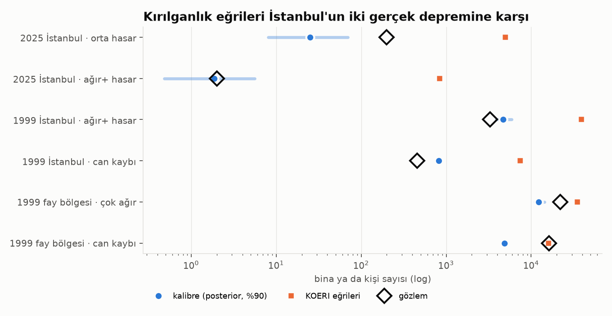
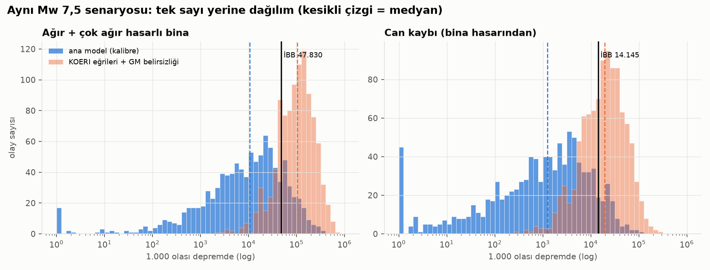
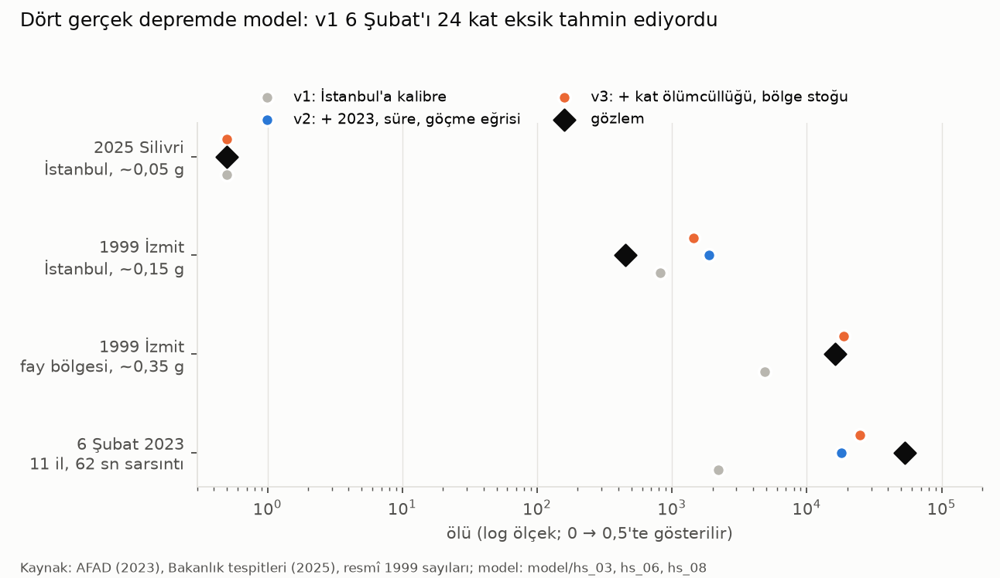

# Yöntem 2 – Bina hasarı, kalibrasyon ve can kaybı

Kod: `model/hs_01…05`, `hasar_motoru.py`. Girdi: Yöntem 1'in 1.000 yer hareketi alanı.

## 1. Envanter (`hs_01_envanter.py`)

İBB 2017 her mahalle için yalnızca marjinalleri verir: 3 yaş sınıfı ve 3 kat sınıfı. KOERI (2010) Tablo 4.1.1 ise şehir
geneli 57 sınıflık (yapı tipi × kat × yaş) envanteri verir; toplamı 1.163.383 bina, İBB 2017'nin 1.165.936'sıyla aynı tabandır.

- Yaş × kat ortak dağılımı: KOERI tablosu tohum, her mahallenin marjinallerine **IPF** (Deming & Stephan 1940).
  En büyük marjinal hata 4·10⁻⁶ bina.
- Yapı tipi: P(tip | yaş, kat) şehir geneli. Sonuç: %81 betonarme çerçeve, %18 yığma.
- Kişi: TÜİK 2025 nüfusu KOERI kat ağırlıklarıyla (6 / 24 / 60 kişi) binalara dağıtılır (gece senaryosu).

## 2. Hasar motoru (`hasar_motoru.py`)

KOERI'nin dört analitik yönteminden **katsayı yöntemi** (ASCE 41-06): Sd = C1·C2·Sa(T)·g·T²/4π², akma ivmesi Ay = Cs·γ/α1
(KOERI Tablo 4.3.1), hasar olasılığı log-normal (KOERI Tablo 4.3.6). Her sınıf kendi periyodundaki Sa'yı görür
(0,3–1,2 s, log-periyotta enterpolasyon). Can kaybı ve yaralanma: KOERI Tablo 4.4.8–9 (HAZUS oranlarının Kocaeli 1999'a göre
~5 kat artırılmış hali). Çok ağır hasarda çökme payı HAZUS-MH'den alınır (betonarme %13/10/5, yığma %15).

**Yöntemin doğrulaması:** Mantık ağacı ağırlıklı medyan yer hareketiyle (ε = 0, İBB'nin yaptığı gibi) çalıştırınca:

| | İBB 2019 | Bu proje (ε = 0) |
|---|---|---|
| Çok ağır | 13.496 | 13.510 |
| Ağır | 34.334 | 36.834 |
| Orta | 146.512 | 151.825 |

Bağımsız kurulan zincir İBB'nin bina hasarını %0–7 farkla yeniden üretiyor. İBB'nin can kaybı modeli raporda tam tanımlı
değil; KOERI tablosu bizde 6.667 veriyor (İBB 14.145).

## 3. Sorun: kırılganlık eğrileri İstanbul'un gerçek deneyimini tutmuyor

İki bağımsız İstanbul deneyimi var:

| Olay | Şiddet | Gözlem | KOERI eğrileri |
|---|---|---|---|
| 23.04.2025 Silivri Mw 6,2 | PGA ~0,03–0,1 g | 8.367 incelemede 437 az hasarlı, ağır+ ~2, ölü 0 | orta 4.971, ağır+ 834 |
| 17.08.1999 İzmit Mw 7,4 | PGA ~0,1–0,2 g | 454 yerel ölü, ~3.300 ağır+ bina (18.162 oturulamaz konut) | ağır+ 39.005, ölü 7.455 |

Eğriler İstanbul'un gördüğü şiddetlerde gözlemi 10–400 kat aşıyor. Bunun iki sebebi var:

1. KOERI raporu β'nın yer hareketi belirsizliğini de içerdiğini yazıyor (§4.3 D-b). GMPE σ ayrıca örneklenince bu belirsizlik
   iki kez sayılır.
2. Log-normal kuyruk, çok düşük talepte bile sıfır olmayan ağır hasar olasılığı verir.

Ama aynı eğriler 1999 fay bölgesinde (PGA 0,3–0,4 g; 16.142 ölü, >20.000 çöken bina, Sezen vd. 2003) gözleme yakın ya da
altında kalıyor. Yani gerçek davranış KOERI'den **daha dik** bir eğri.

## 4. Kalibrasyon (`hs_03_kalibrasyon.py`)

Parametreler: s_β (β çarpanı), θ_ho / θ_ac (hafif–orta ve ağır–çok ağır medyan ölçekleri), κ (can kaybı oranı çarpanı, önsel
ln κ ~ N(0; 0,7)). Üç rejim: 2025 İstanbul, 1999 İstanbul (2000 öncesi stok, 10,0 M nüfus), 1999 fay bölgesi (WorldPop 2000,
2.751 hücre, 2,73 M kişi; envanter karışımı İstanbul 2000 öncesi stoğundan vekil). Gözlemler Poisson (küçük sayılar) ve
log-normal (büyük sayılar) olabilirlikle; 144 noktalık ızgara, olabilirlik ağırlıklı posterior.

**Gözlem eşleştirme kararları (sonucu etkiler, açıkça yazılı):** HAZUS "orta" (kolonlarda kılcal çatlak) Türk tespit pratiğinde
"az hasar"dır ⇒ 2025 orta ~200 (σ_ln 1,0). 1999 "oturulamaz konut" ⇒ HAZUS ağır+ (bina başına 4–8 konut). 1999 bölge
"çöken bina" ⇒ HAZUS çok ağır.

**Sonuç:** s_β ≈ 0,47, θ_ho ≈ 3,1, θ_ac ≈ 3,2, κ ≈ 1,0.

- İstanbul'un stoğu iki depremde de KOERI eğrilerinden ~3 kat dayanıklı davranmış.
- **Dolgu duvar hipotezi (θ_ho > θ_ac) desteklenmedi:** veri her iki ölçeği de ~3 istiyor.
- **Kalan uyumsuzluk:** aynı parametreler 1999 fay bölgesinde çökmeyi ~2 kat, ölümü ~3 kat düşük tahmin ediyor. Bölge stoğu
  daha kırılgandı (hızlı 1980–99 yapılaşması, Adapazarı yumuşak zemini) ve vekil envanter bunu taşıyamaz. Mw 7,5 senaryosu
  İstanbul'un deneyimlediği en yüksek şiddetin (~0,2 g) üstüne çıktığı için ana model bir **dışdeğerlemedir** ve büyük
  ihtimalle alt taraftadır.

## 5. Senaryo: üç katman (`hs_02_hasar.py`)

| Katman | Ağır+ bina medyan [%5–%95] | Ölü medyan [%5–%95] |
|---|---|---|
| İBB-eşdeğeri (ε = 0, KOERI) | 50.344 | 6.667 |
| **Ana: 1.000 GM alanı × kalibrasyon posterioru** | **10.486 [147 – 106.326]** | **1.240 [2 – 22.798]** |
| KOERI eğrileri + GM belirsizliği (üst sınır) | 103.200 [18.237 – 331.064] | 19.550 [2.548 – 85.052] |

Okuma:
- Deterministik senaryo bir dağılımın tek noktasıdır. İBB'nin 14.145'i ana modelde ~%90'lık dilimde.
- Dağılımın genişliği büyük ölçüde olaylar arası terimden (η) geliyor: tüm şehir aynı anda "şanslı" ya da "şanssız" olur.
  Bu, kaynak planlamasında tek sayının neden yetersiz olduğunun sayısal kanıtıdır.
- 72 saat simülatörü ana katmanı kullanır. KOERI katmanı duyarlılık olarak koşulur.

## 6. 6 Şubat sınavı ve neden ölüm sayısı vermiyoruz (`sinama/`, `hs_06`, `hs_08`, `hs_09`)

Yukarıdaki ana model, İstanbul'un 1999 ve 2025 deneyimine kalibre edildi. Bir modelin büyük bir depremde ne yaptığını görmenin tek
yolu onu büyük bir depremle sınamak: 6 Şubat 2023.

**Kurulum (`sinama/s01–s03`).** 11 ilin gece nüfusu (GHSL 2020, 3″), iki ana şokun USGS ShakeMap'i (istasyon koşullu; büyük
bileşen → RotD50, Boore & Kishida 2017), bina yaşı uydudan (GHSL yapılaşma dönemleri; İstanbul'da İBB sayımına uydurulan eşlemeyle,
R² 0,40) ve kat/tip yaşa koşullu olarak İstanbul envanterinden. Deprem de senaryo gibi gece (04:17).

| Model | 6 Şubat için tahmin | Gerçek (AFAD) |
|---|---|---|
| İBB'nin yöntemi (KOERI eğrileri) | ~15.400 | 53.537 |
| USGS PAGER, Türkiye'ye kalibre (Jaiswal vd. 2009) | ~21.300 | |
| Bu proje v1 (İstanbul'a kalibre) | ~2.200 | |

**v2 (`hs_06`).** Dört deprem birlikte; sarsıntı süresi (Afshari & Stewart 2016 Ds5-95; 6 Şubat'ta medyan 62 sn, İstanbul senaryosunda
27 sn), ayrı göçme eğrisi ve göçmede ölümcüllük λ. Teşhis: v1'in yapısı İstanbul 1999 ile fay bölgesi 1999 arasındaki kişi başı ölüm
farkını (gözlem ~×130) hiçbir parametreyle üretemiyordu (en fazla ~×25), çünkü HAZUS-TR çökmemiş çok ağır hasarda %4 ölüm verir.

**v3 (`hs_08`).** Kat yüksekliğine bağlı ölümcüllük (μ ≈ 1,7: 5–8 kat göçmesi 1–4 kattan ~1,7 kat ölümcül), bölge stok kalitesi δ.

| Deprem | Gözlem | v1 | v2 | v3 |
|---|---|---|---|---|
| 2025 Silivri | 0 | 0 | 0 | 0 |
| 1999 İstanbul | 454 | 815 | 1.874 | 1.436 |
| 1999 fay bölgesi | 16.142 | 4.854 | 17.739 | 18.664 |
| 6 Şubat 2023 | 53.537 | 2.209 | 17.991 | 24.677 |

**Neden durduk.** v3 fay bölgesini tutturdu ama İstanbul 1999'u ~3 kat fazla, 6 Şubat'ı ~2 kat eksik tahmin etti; parametreler
ızgara sınırlarına dayandı. Ölümleri sınıflara ayırınca asıl hata göründü: model 1999 fay bölgesi ölümlerinin %69'unu yığma,
%3'ünü 5+ katlı betonarme binalara yüklüyordu; gözlem tersini söyler (">20.000 betonarme çerçeve bina çöktü", Sezen vd. 2003).
Sınıfa özgü bir kalibrasyon (v4) tasarlandı ama çalıştırılmadı: bunu çözmek için bina tipine ve kat sayısına
göre ayrılmış gerçek hasar verisi gerekir (Bakanlığın 2,15 milyon binalık tespiti; Yılmaz vd. 2024), bu veri toplu olarak açık değil.

**Karar.** Bu projede İstanbul için ölüm sayısı yayımlanmaz. Hasar modeli yalnızca kaba büyüklük için (hangi mahallede kaç kişi ağır/orta
hasarlı binada) ihtiyaç analizine girer; orada da sonuç asıl olarak nüfus ve alan geometrisine dayanır (YONTEM_5).

Ek kaynaklar: Chandramohan, Baker & Deierlein (2015, 2016) · Ceferino vd. (2025) · Jaiswal, Wald & Hearne (2009) USGS OFR 2009-1136 ·
SBB (2023) Kahramanmaraş ve Hatay Depremleri Raporu · JRC GHSL R2023A.

## Kaynaklar

KOERI/OYO (2010) İBB kayıp tahminleri güncellemesi (Tablo 4.1.1, 4.3.1, 4.3.6, 4.4.8–9) · FEMA/NIBS HAZUS-MH Technical Manual ·
ASCE/SEI 41-06 · Deming & Stephan (1940) Ann. Math. Stat. 11 · Sezen vd. (2003) Eng. Struct. 25 · Çevre, Şehircilik ve
İklim Değişikliği Bakanlığı 2025 Silivri depremi hasar tespit açıklamaları · WorldPop (2018) Global 1 km population 2000.
