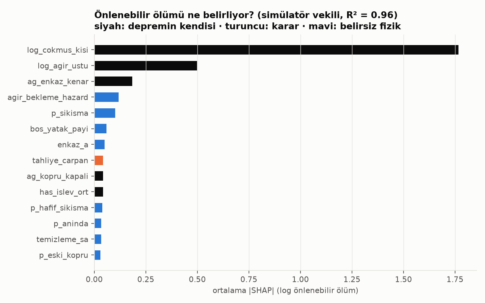

# Yöntem 3 – 72 saat müdahale simülatörü ve optimizasyon

Kod: `sim/`. Girdi: Yöntem 2'nin ana katmanı (1.000 gerçekleşme × mahalle hasarı ve çöken binadaki kişi).

## Model

Adım 15 dk, ufuk 72 sa. Kurbanlar mahalle başına sürekli havuzlar (beklenen değer), ekipler kesikli ajanlar.

| Bileşen | Model | Kaynak / gerekçe |
|---|---|---|
| Enkaz altı | Çöken binadaki kişilerin p_sıkışma'sı (0,20) enkazda kalır, p_anında'sı (0,20) çökmede ölür; kalan canlılar hafif (0,5, komşular çıkarabilir) ve ağır sıkışmış | Coburn & Spence (2002) M3–M5; toplam %10'luk çökme ölümü hs_03 kalibrasyonuyla tutarlı |
| Sağ kalma | Weibull λ = 51 sa, k = 1,11; 72. saatte canlı sıkışmışın %23'ü yaşıyor | Coburn vd. (1992) gün bazında canlı çıkarılma oranlarına uydurma |
| Toplum kurtarması | Hafif sıkışmışlara saatlik 0,15 hazard × (1 − 3·çok ağır hasar payı) | Noji (1997), Macintyre vd. (2006): kurtarmaların çoğu ilk saatlerde ve komşulardan |
| Profesyonel ekipler | İBB: 120 ekip t=0'da, 60 ekip 3. saatte (5.082 itfaiyeci, 173 kurtarma aracı, gece vardiyası ~1/3); ulusal 300 ekip 6–24 sa doğu/batı kapısından; uluslararası 80 ekip 24–48 sa havalimanlarından | İBB Açık Veri 2025; ulusal/uluslararası sayılar varsayım, aralıkla taranır |
| Kurtarma süresi | Ağır sıkışmış başına 3 ekip-saat; bir binada eş zamanlı ekip ≤ çöken bina sayısı | Aralık 2–6 sa |
| Yol ağı | Arterler (72 bin düğüm). Köprü/alt geçit HAZUS HWB5/HWB10 Sa(1 s), tünel PGA; yapı başına tek hasar örneği. Enkaz: p = 1−exp(−a·c·ağır+ bina/km), %25 tam kapanma, kalan ×4 yavaş; açılma üstel (24 sa; İBB 1. derece acil yollarında 8 sa). Trafik ×2,5 (0–6 sa), ×1,8 (6–24), ×1,3 | HAZUS-MH; İBB UKOME 2024 acil yollar |
| Son kilometre | Araçla ulaşılamayan mahalleye 3 km içindeki komşudan yürüyerek (4 km/sa) | 2023 Hatay deneyimi |
| Hastane | Kapasite = tahmini yatak × boş pay (0,30) × genişleme (1,5) × bina işlevi (kalibre kırılganlık; şehir hastaneleri izolatörlü). Saatlik atama, 2 sa içindeki en yakın kapasiteli hastane, önce ağır yaralı. Tedavi bekleyen ağır yaralı 0,01/sa ölüm hazardı; tedavi edilende %5 | |
| Sevk politikaları | yakın, fayda (kalan/(atanan+1)/(yol+işlem)), eşitlik (önce ekip görmemiş ve yoksun mahalle), koordineli (LP planını izler) | |

Doğrulama: kütle dengesi (sıkışan = kurtarılan + ölen + kalan) her koşuda 10⁻¹³ içinde; motorun hızlandırılmış sürümü
kayıtlı sonucu birebir üretiyor (8,733 = 8,733).

## Deneyler

- **D1**: 1.000 gerçekleşmeden ağır+ hasara göre sistematik 240 tanesi; fiziksel parametreler Latin hiperküp; 3 politika aynı
  gerçekleşme ve tohumla (ortak rastgele sayılar, eşleştirilmiş fark + bootstrap %95 GA).
- **D2**: aynı ağlarla gerçekleşme başına 25 LHS örneği (kollar + fizik + politika), ~6.000 koşu: duyarlılık ve ML vekil verisi.

## Optimizasyon

- **Eşitlik kısıtlı tahsis (LP)**: zaman genişletilmiş; sağ kalma doğrusal yazılır (τ'da canlı kurtarılan bir kişi başlangıçtaki
  1/S(t_τ) kurbanı temsil eder). z ile her mahallenin kurtarılma oranına alt sınır; adaletin bedeli (Bertsimas vd. 2011).
- **Sahra hastanesi yeri (MCLP, SAA)**: 830 aday (≥ 1 ha açık alan), 24 eğitim gerçekleşmesi, hasarlı ağda 45 dk kapsama;
  24 örneklem dışı gerçekleşmede tam simülatörle sınama (150 yatak, 12. saatte açılış).

## Sonuçlar (240 gerçekleşme, D1; `data/processed/sim/analiz/`)

**Ölümler nereden geliyor** ("en çok fayda" politikası):

| | Medyan | %5 – %95 | Ortalama |
|---|---|---|---|
| Toplam | 1.336 | 2 – 30.981 | 6.067 |
| Çökme anında | 1.039 | 2 – 19.328 | 4.118 |
| Enkaz altında beklerken | 61 | 0 – 3.825 | 666 |
| Hastanede yer beklerken | 163 | 0 – 6.292 | 1.193 |
| Canlı sıkışan / kurtarılan | 483 / 391 | | 1.953 / 1.261 |

Ortalama ölümün **%68'i çökme anında** (müdahaleyle değişmez; tek kaldıraç binayı güçlendirmek). Önlenebilir kısmın
**hastane beklemesi (%20), enkaz altı ölümlerinin (%11) yaklaşık iki katı**.

**Sevk politikaları** (eşleştirilmiş fark, olay başına, bootstrap %95 GA):

| Karşılaştırma | Ölüm | Hiç ekip görmeyen mahalle | İlk ekip varışı (mahalle medyanı) |
|---|---|---|---|
| En çok fayda − en yakın | −18,0 (−27,2; −10,4) | +4,9 (3,7; 6,2) | +1,7 sa (0,9; 2,5) |
| Eşitlik − en çok fayda | +2,5 (1,4; 3,9) | −1,4 (−2,2; −0,9) | −2,6 sa (−3,3; −1,9) |
| Eşitlik − en yakın | −15,5 (−23,7; −8,9) | +3,5 (2,5; 4,7) | −0,9 sa (−1,4; −0,4) |

Okuma: verimlilik kuralı en yakın enkaza koşmaktan iyi; eşitlik kuralı bunun üstüne ilk ekibi 2,6 saat erken ulaştırıyor ve
bedeli olay başına 2,5 can (ortalama ölümün %0,04'ü). **Adaletin bedeli neredeyse sıfır.** LP de aynı şeyi söylüyor:
eşitlik alt sınırı olurluluk sınırına kadar toplam kurtarmayı düşürmüyor; bağlayıcı olan ekip sayısı değil, erişim ve zaman.

**Kim yardımsız kalıyor?** Adalar'ın 5 mahallesi kara yoluyla hiç erişilemiyor (deniz lojistiği modellenmedi). Karada en
riskli Beşyol: etkilendiği depremlerin %43'ünde ilk 24 saatte hiç ekip görmüyor (eşitlikle %33); ardından Ataköy kısımları,
Şirinevler, Basınköy.

**Sahra hastanesi** (örneklem dışı 24 büyük deprem, olay başına kurtarılan can, ±SE):

| K | Hasarlı ağa göre MCLP | Kuş uçuşu MCLP | En büyük açık alanlar |
|---|---|---|---|
| 5 | 96 (±22) | 63 (±15) | 46 (±12) |
| 10 | 174 (±39) | 103 (±24) | 91 (±23) |
| 20 | 301 (±71) | 143 (±38) | 175 (±41) |

Yeri hasarlı yol ağında seçmek, sezgisel seçimin yaklaşık iki katı can kurtarıyor.

**Vekil model ve duyarlılık** (`ml/ml_02_sim_vekil.py`, 6.000 koşu): gerçekleşme dışı R²(log) 0,96, medyan göreli hata %22,
conformal %90 kapsama 0,90. SHAP sıralaması: depremin kendisi (çöken binadaki kişi, ağır+ hasar, enkazlı yol) ≫ hastane
tarafı (bekleme ölüm hazardı, boş yatak, genişleme) > ekip sayıları. Karar düzeyinde en etkili kol hastane kapasitesi.

