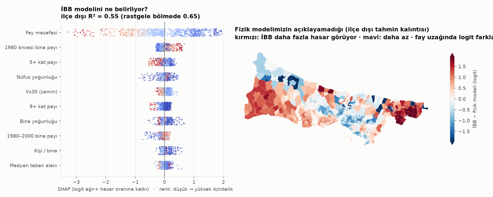

# Yöntem 4 – Makine öğrenmesi

## İBB'nin hasar modelini tersine mühendislik (`ml/ml_01_ibb_vekil.py`)

Hedef: İBB senaryosundaki mahalle ağır+ hasar oranı (logit). Bu bir deprem tahmini değil, "İBB'nin modeli neyi görüyor?"
sorusudur. Doğrulama ilçe bazlı GroupKFold; rastgele bölme komşu mahallelerden sızdırır.

| Model | R² ilçe dışı | R² rastgele | Spearman (ilçe dışı) |
|---|---|---|---|
| Yalnız fizik (bizim KOERI zinciri, ε = 0) | 0,50 | 0,51 | 0,72 |
| LightGBM, veri güdümlü | 0,55 | 0,65 | 0,79 |
| LightGBM, fizik bilgili | **0,59** | 0,67 | 0,80 |

- Rastgele bölme R²'yi ~0,1 şişiriyor: mekânsal verilerde bölme stratejisi sonucu değiştirir.
- SHAP: İBB'nin modelini açık ara fay mesafesi belirliyor; ardından 1980 öncesi bina payı ve 5+ kat payı.
- Kalıntı haritası: fizik modelimiz İBB'yi Avrupa yakasının batı kıyısında düşük, Kadıköy–Ümraniye–Ataşehir hattında yüksek
  tahmin ediyor. İBB'nin mikrobölgeleme zemin verisiyle ve iki çalışmanın fay geometrisi farkıyla tutarlı; ikisi ayrıştırılamaz.

## Simülatör vekili (`ml/ml_02_sim_vekil.py`)

D2'nin 6.000 koşusu; hedef log(1 + önlenebilir ölüm). Gerçekleşmeye göre gruplu CV R² 0,96; split-conformal %90 aralık
(kapsama 0,90). Model JSON olarak web'e taşınır ve tarayıcıda değerlendirilir; TypeScript değerlendiricisi Python
tahminlerini 10⁻⁹ içinde yeniden üretir (`web/test/agac.test.ts`).
